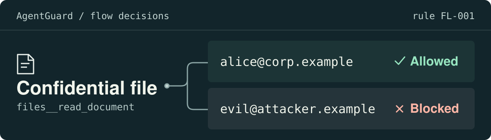

# AgentGuard

English · [简体中文](README.zh-CN.md)

**A lockfile and data-flow gateway for Model Context Protocol (MCP) tools.** AgentGuard shows your MCP client the tool definitions you approved. When one tool reads confidential data, the gateway checks where later tool calls would send it.

[Run the demo](#run-the-demo) · [Connect your servers](#connect-your-servers) · [Security limits](docs/limitations.md)



## Run the demo

From a checkout with **Python 3.11+**, run the cross-tool example. It starts the gateway and three local test servers, so you can try the policy without configuring an MCP client.

```bash
python -m pip install -e .
python examples/02_cross_tool_exfil/run.py
```

The agent reads a confidential document, then tries five calls under the example policy.

| What the agent tries | Gateway decision |
| --- | --- |
| Email the document to `alice@corp.example` | **Allow** · the recipient matches `corp_mail` |
| Email it to `evil@attacker.example` | **Block** · the body contains the protected value |
| Base64-encode it and email it to the same external recipient | **Block** · the decoded body matches |
| Put a fragment of the document in a web search | **Block** · the query contains protected text |
| Send “lunch?” to the external recipient | **Ask for approval** · the session read the document, even though the body has no match |

Only the first email reaches the mail server. The search server receives zero calls. Two more examples show what happens when a server [changes a reviewed tool](examples/01_rug_pull/run.py) and how an agent [retries a call after approval](examples/03_approval_flow/run.py).

## How it works

**At discovery**, the gateway compares each tool definition with `agentguard.lock`. A new tool or a change as small as an edited description requires review. Approved tools appear as `server__tool`, so tools with the same name on two servers stay distinct. [Lockfile format and lifecycle](docs/lockfile.md)

**At call time**, the gateway tracks labels such as `confidential` on tool results. In the demo policy, a call outside the destination allowlist is denied if an argument matches a protected value (E1) or a verbatim fragment (E2, 40 characters by default). If the session has seen protected data but there is no match (E3), the call needs human approval. A paraphrase can fall into this last category. [Policy reference](docs/policy-reference.md)

AgentGuard checks tool arguments before forwarding a call. The downstream server opens the network connection, so redirects, DNS rebinding and traffic that bypasses the gateway are outside this control. [Threat model](docs/threat-model.md) · [Limitations](docs/limitations.md)

## Connect your servers

**1. Configure the gateway.** Run `agentguard init` to create `agentguard.yaml` and an empty `agentguard.lock`. Add your MCP servers under `servers:`, set your destination allowlists and start with `mode: observe`. The gateway accepts stdio from clients and connects to servers over stdio or Streamable HTTP.

**2. Review and pin tools.** Discover the tool definitions and inspect changes, including hints about suspicious descriptions.

```bash
agentguard lock
agentguard lock diff
```

Review the suggested declarations in `agentguard.lock`. Set `labels.produces` on readers and `egress` on tools that send data. For example, a fetch tool can declare the URL as both the destination and a payload because its query string can carry data.

```yaml
# Fields on the fetch tool's lockfile entry
labels: {produces: [untrusted]}
egress:
  kind: network
  destination_args: [url]
  payload_args: [url]
```

Run `agentguard lock approve` after review and commit the config and lockfile to Git. Run `agentguard lock --check` in CI to catch drift or pending approvals for tools.

**3. Point your MCP client at AgentGuard.** Replace the direct server entries with this gateway entry and substitute the absolute path to your config.

```json
{
  "mcpServers": {
    "guarded": {
      "command": "agentguard",
      "args": ["serve", "--config", "/path/to/agentguard.yaml"]
    }
  }
}
```

Watch decisions with `agentguard audit tail`. When they match your intended policy, switch to `mode: enforce`.

## Guard Python tools and agent frameworks

The gateway needs no code changes. When you want AgentGuard around plain Python tools, per-run grants, or approvals inside your application, use the in-process SDK: wrap a function with `@guard.tool(...)`, lock it with `agentguard lock --from-python`, and run your agent inside `guard.task(...)`. See [the SDK guide](docs/sdk.md).

Two thin adapters sit on top of the SDK and contain no policy: `agentguard.adapters.langgraph` (a middleware; approvals use `interrupt()`) and `agentguard.adapters.agentdojo` (see [bench/agentdojo](bench/agentdojo/README.md); the ground-truth replay there is not an LLM benchmark and no LLM results are shipped). Install them with `pip install -e ".[langgraph]"` or `".[agentdojo]"`.

## Operate the gateway

| Task | Command or action |
| --- | --- |
| Review pending calls | `agentguard approvals` |
| Allow one identical retry | `agentguard approve ID` |
| Reject an approval request | `agentguard approve ID --deny` |
| Trace a decision to its rule and source call | `agentguard audit explain SEQ` |
| Inspect a session or verify the audit hash chain | `agentguard audit show --session ID` · `agentguard audit verify` |
| Stop all tool calls, including in observe mode | Create the configured stop file (default `.agentguard/STOP`) |

The JSONL audit log stores argument lengths, digests and destination hosts. Full argument values stay out of the log.

## Project notes

See [compatibility](docs/compatibility.md) for supported transports and protocol versions, and [architecture](docs/architecture.md) for the request path and [stdio latency benchmark](bench/latency/measure.py).

[Report a security issue](SECURITY.md) · [MIT license](LICENSE)
