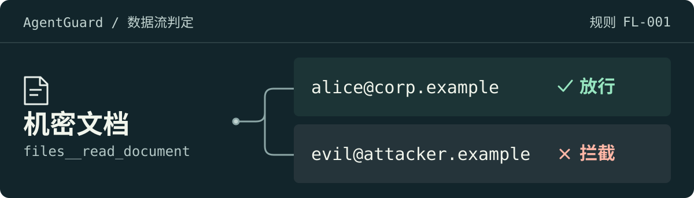

# AgentGuard

[English](README.md) · 简体中文

**AgentGuard 让你审核智能体可以使用哪些工具，并控制工具之间的数据流向。** 例如，你可以允许智能体读取内部文档、用邮件发给同事，同时拦截它把同一段原文放进网页搜索框的尝试。已有 MCP 客户端可以通过网关接入；Python 应用可以直接用 SDK 包装本地函数。

[运行示例](#运行示例) · [接入 MCP 服务器](#接入-mcp-服务器) · [接入 Python 函数](#接入-python-函数) · [审批与审计](#审批与审计) · [防护边界](#防护边界)



## 运行示例

在仓库根目录，使用 **Python 3.11 或更高版本**运行下面两条命令。示例会启动网关和三个本地测试服务器，无需配置 MCP 客户端。

```bash
python -m pip install -e .
python examples/02_cross_tool_exfil/run.py
```

智能体先读取一份机密文档，再尝试五次工具调用。示例策略会给出三种不同的处理结果。

| 智能体的操作 | 网关如何处理 |
| --- | --- |
| 将文档发给 `alice@corp.example` | **放行**。收件人匹配 `corp_mail` 允许列表。 |
| 将同一份文档发给 `evil@attacker.example` | **拦截**。邮件正文包含受保护的原文。 |
| 将文档用 Base64 编码，再发给同一外部收件人 | **拦截**。解码后的正文仍然匹配原文。 |
| 将文档中的一段原文作为搜索词 | **拦截**。搜索请求中包含受保护的片段。 |
| 只给外部收件人发一句“吃午饭吗？”（示例原文为 `lunch?`） | **请求人工审批**。正文没有匹配原文，但本次会话已读取机密数据。 |

最终，邮件服务器只收到第一封邮件，搜索服务器没有收到任何调用。另外两个示例分别演示[服务器更改已审核的工具定义](examples/01_rug_pull/run.py)和[智能体在人工批准后重试调用](examples/03_approval_flow/run.py)。

## 工作原理

**发现工具时**，网关逐一对照 `agentguard.lock` 核验工具定义。新工具需要审核，已审核的工具即使只改了描述，也需要重新审核。网关以 `server__tool` 的形式向客户端提供工具，因此不同服务器上的同名工具可以明确区分。详见[锁文件格式与审核流程](docs/lockfile.zh-CN.md)。

**调用工具时**，网关跟踪工具返回结果上的标签，例如 `confidential`。在示例策略中，如果目的地不在允许列表内，且调用参数匹配完整的受保护值（E1）或一段原文（E2，默认至少 40 个字符），网关就会拦截调用。如果参数没有匹配，但本次会话曾读取受保护数据（E3），则转交人工审批。用自己的话转述机密文档，就可能属于第三种情况。详见[策略参考](docs/policy-reference.zh-CN.md)。

示例的核心策略如下。这段 YAML 在 `agentguard.yaml` 的 `flow` 下定义允许的收件人、受保护的标签，以及各类证据对应的处理方式。

```yaml
flow:
  destinations:
    corp_mail: ["*@corp.example"]
  rules:
    - id: FL-001
      from: [confidential, secret]
      to: {kind: [network, message]}
      allow_destinations: [corp_mail]
      on_value_match: deny
      on_session_exposure: require_approval
```

## 接入 MCP 服务器

**1. 配置网关。** 运行 `agentguard init`，创建 `agentguard.yaml` 和空的 `agentguard.lock`。在配置文件的 `servers:` 下添加 MCP 服务器，按实际域名设置允许的目的地。客户端通过标准输入输出（stdio）连接网关，网关通过 stdio 或 Streamable HTTP 连接下游服务器。首次接入可以设为 `mode: observe`，查看策略原本会拦截哪些调用；需要实际拦截时使用 `mode: enforce`。

**2. 审核并锁定工具定义。** 运行以下命令获取工具定义、查看变更，并检查有关可疑工具描述的提示。

```bash
agentguard lock
agentguard lock diff
```

核对 `agentguard.lock` 中自动生成的声明。对读取数据的工具，用 `labels.produces` 标记其返回的数据；对发送数据的工具，用 `egress` 声明数据发往何处、哪些参数可能携带数据。例如，网页抓取工具的 URL 既指明目的地，也可以通过查询字符串携带数据，因此两个字段都应包含 `url`。

```yaml
# 锁文件中 fetch 工具条目的部分字段
labels: {produces: [untrusted]}
egress:
  kind: network
  destination_args: [url]
  payload_args: [url]
```

审核完成后运行 `agentguard lock approve`，并将配置和锁文件提交到 Git。在 CI 中运行 `agentguard lock --check`，即可发现工具定义变更或仍待审核的工具。

**3. 将 MCP 客户端指向网关。** 用下面的网关配置替换客户端中原先直连各服务器的条目，并将示例路径换成配置文件的实际绝对路径。

```json
{
  "mcpServers": {
    "guarded": {
      "command": "agentguard",
      "args": ["serve", "--config", "/path/to/agentguard.yaml"]
    }
  }
}
```

运行 `agentguard audit tail` 查看网关的判定。结果符合预期后，将配置改为 `mode: enforce`，开始执行策略。

## 接入 Python 函数

工具是本地函数时，可以在进程内复用同一套锁文件、策略和审计机制。下面的示例只在本地生成报告标题，用它可以验证从登记工具到首次调用的完整流程。

安装本项目后，在一个空目录里运行 `python -m agentguard init`，保留默认的 `mode: enforce`。将以下内容保存为 `report_tools.py`。

```python
from pathlib import Path

from agentguard import Guard

guard = Guard.from_files(Path("agentguard.yaml"))


@guard.tool("report_title")
def report_title(topic: str) -> str:
    """为指定主题生成周报标题。"""
    return f"{topic}周报"


if __name__ == "__main__":
    with guard.task(principal="analyst", run_id="weekly-report"):
        print(report_title("库存"))
```

在同一目录依次运行以下命令。前三条记录、展示并批准函数的工具定义，第四条执行经审核的函数，预期输出为 `库存周报`。

```bash
python -m agentguard lock --from-python report_tools:report_title
python -m agentguard lock diff --from-python report_tools:report_title
python -m agentguard lock approve --from-python report_tools:report_title
python report_tools.py
```

该函数在策略中的名称是 `local__report_title`。在同一个 `Guard` 实例中，同一主体使用相同的 `run_id` 可以延续会话的数据标签。独立任务应使用不同的 `run_id`。本地工具的锁文件覆盖名称、文档字符串和参数签名，函数体的变更需要通过代码审查核验。异步函数、任务授权和应用内审批见 [Python SDK 指南](docs/sdk.zh-CN.md)。

## 审批与审计

| 任务 | 命令或操作 |
| --- | --- |
| 查看等待审批的调用 | `agentguard approvals` |
| 批准一次相同调用的重试 | `agentguard approve ID` |
| 拒绝审批请求 | `agentguard approve ID --deny` |
| 查询某次判定命中了哪条规则，数据来自哪次调用 | `agentguard audit explain SEQ` |
| 查看某个会话的调用记录 | `agentguard audit show --session ID` |
| 校验审计日志的哈希链 | `agentguard audit verify` |
| 紧急停止所有工具调用（观察模式下也生效） | 创建配置指定的停止文件，默认为 `.agentguard/STOP` |

将 `ID` 换成相应的审批或会话 ID，将 `SEQ` 换成审计日志中对应判定的序号。JSONL 审计日志记录参数长度、摘要和目标主机，不保存完整参数值。

## 防护边界

| 场景 | 如何理解网关的判定 |
| --- | --- |
| 机密内容经过摘要、翻译或改写 | 原文匹配可能失效。示例策略会根据会话已接触机密数据这一事实，对允许列表外的调用请求人工审批。 |
| 工具访问 URL 后遇到重定向或 DNS 重绑定 | 网关检查调用参数里的地址，建立连接和跟随重定向的是下游服务器。限制实际网络连接需要在服务器侧实施。 |
| 客户端或服务器自行发起请求 | 绕过网关的流量不经过工具策略。已被攻陷的服务器也可能自行发送它能访问的数据。 |
| 审计日志被整个删除 | 哈希链可用于核验现有记录。需要保留独立证据时，应将日志同步到只可追加的外部存储。 |

详见[威胁模型](docs/threat-model.zh-CN.md)和[实现限制](docs/limitations.zh-CN.md)。

## 开发与项目资料

在仓库根目录安装开发依赖并运行测试。集成测试会启动本地网关和测试服务器。

```bash
python -m pip install -e ".[dev]"
python -m pytest
```

[v0.1.0 变更记录](CHANGELOG.zh-CN.md)列出了网关功能及发布状态，[兼容性说明](docs/compatibility.zh-CN.md)列出了支持的传输方式和协议版本。[架构说明](docs/architecture.zh-CN.md)介绍了网关处理请求的流程，也可以运行 [stdio 延迟基准脚本](bench/latency/measure.py)测量调用开销。

[贡献指南](CONTRIBUTING.zh-CN.md) · [报告安全问题](SECURITY.md) · [MIT 许可证](LICENSE)

中文文档的完整导航见[文档索引](docs/README.zh-CN.md)。
